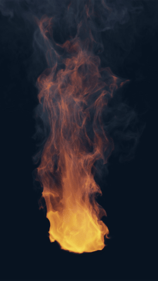
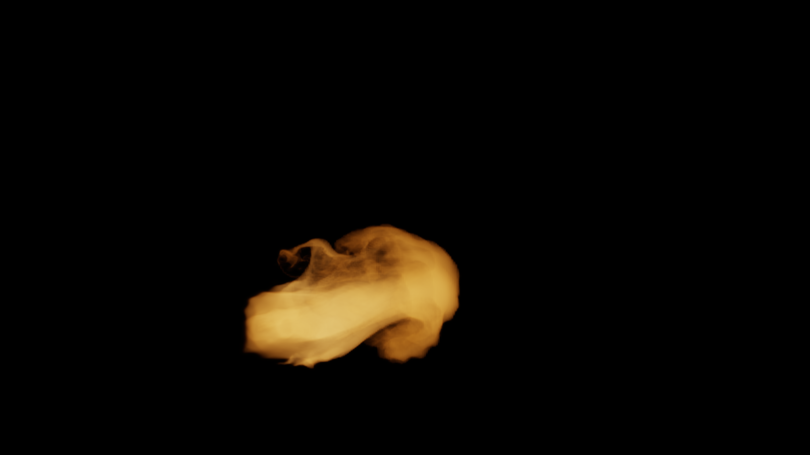

# CYBR FIRE V8

Native OpenGL compute fire studies: a staggered-grid parent solver, one-way fine reactive-scalar transport, volumetric rendering, and resumable production/checkpoint tools. This is research/VFX code, not validated fire-safety software.



The GIF is a reduced-size preview of the **original 24-frame, one-second, 2160×3840 V8 clip**, not a new five-second jet/pool/fireball delivery. [Original 4K MP4](media/v8-original-1s-4k.mp4) · [Frame still](media/v8-original-still.png)



The later jet image is a separate native 3840×2160 cold-start study. It does not establish visual parity with the mature original burner. Its [archived report](evidence/native-jet-still.json) records that distinction.

## What is here

- `cybrfire/` and `shaders/`: current independent-scene V8 engine, chemistry, advection, pressure projection, surface fuel, fine transport, optical sampling and renderer.
- `tools/build_scene_cache.py`, `tools/capture_scene.py`, `tools/native_batch.py`: separate parent, fine/capture and encoding stages for `jet`, `pool`, and `fireball`.
- `tools/native_band_resume.py`, `tools/run_native_bands.sh`: later native 4K row-band renderer, layered over the independent-batch engine. It has a fixed landscape camera and is not a generic portrait-scene renderer.
- `checkpoint_guard/`: latest applied immutable checkpoint, restore, remote-receipt and guarded advancement tools. Private storage identities and raw execution logs are not included.
- `tests/`, `evidence/`, `evidence-v8/`: supplied checks and historical reports. These are not claims that tests were rerun during repository preparation.
- `docs/`, `README_*.md`, `baseline/`: method notes and historical lineage. `baseline/V7_source.zip` is the reviewed original legacy source dependency used by the historical release packager, not the main repository payload.

The publication combines the complete independent-batch source, the later band-render overlay, and the later applied checkpoint tools. The camera/solver source in the independent-batch archive already incorporates the preceding camera upgrade; that older duplicate is not overlaid again. A few tool defaults use portable project-relative output paths rather than the original temporary runtime location. Solver and shader algorithms are unchanged.

## Physical model and limits

The native tier uses a **160×280×160 parent velocity/pressure grid (7,168,000 cells)** and **384×672×384 fine scalar grid (99,090,432 cells)**. Fine cells hold fuel, oxygen deficit, sensible energy, and soot; this is **not a 99-million-cell pressure solve**. Parent integration is 120 Hz. The capture uses two fine steps per 24-FPS output interval.

Fine scalar transport uses parent velocity plus explicitly modeled transverse modes. Fine heat does not feed back into parent momentum. Cached flow is FP16 while fine scalar storage and parent fields are FP32. Bounded transport is not exactly mass conservative, convergence is not established, and the turbulence model is not experimentally calibrated. Fireball expansion is low-Mach VFX modeling, not a compressible shock solver. Pool surface fuel is finite-mass but not general liquid-fuel or structural combustion. See [detail ownership and numerical method](docs/DETAIL_REBUILD.md).

## Requirements

- Python 3.11+ for the combined tooling; NumPy, SciPy and Pillow via `requirements.txt`.
- Linux/EGL with **OpenGL 4.5** and the relevant system GL/EGL libraries. The custom ctypes runtime is in `cybrfire/gpu.py`; a bare GL 4.3 context is insufficient for slab readback.
- FFmpeg/ffprobe for encoding and checking movies; Bash for shell wrappers.
- Ample RAM, VRAM and disk. A single full fine-state NPY is about **1.59 GB**, before other fields and snapshots. The earlier software-GL environment was extremely slow. Allow at least 6 GiB free host RAM for the original fine pipeline and measure actual GPU/host allocation requirements. Do not run parent and fine stages concurrently on a memory-limited machine.

`requirements-tested.txt` preserves historically recorded versions, not a new cross-platform guarantee. No dependencies are installed or bundled automatically.

## Run checks

From the repository root, in an isolated Python environment:

```bash
python -m pip install -r requirements.txt
OPENBLAS_NUM_THREADS=1 LP_NUM_THREADS=4 python tests/test_detail.py
python -m cybrfire test
python checkpoint_guard/test_checkpoint_guard.py
```

Some checks create a real GL context and/or need generated integration fixtures. Inspect the test requirements before running a large job. Repository preparation checked syntax, file completeness, media decoding and public-data hygiene only; it did **not execute this engine** or rerun historical numerical tests.

## Build independent scenes from initial conditions

Unlike the original mature-burner reproduction, this path constructs its own initially quiescent scenario and does not require the old V7 starting-state archive:

```bash
# One native parent batch; repeat as needed.
python tools/native_batch.py --scene jet --out production/jet --stage parent --frames 120 --batch 1

# One fine/capture batch, once the needed parent snapshots exist.
python tools/native_batch.py --scene jet --out production/jet --stage capture --frames 120 --batch 1

# Read progress without a physics step.
python tools/native_batch.py --scene jet --out production/jet --stage status --frames 120
```

The ordinary independent driver uses 24 warmup intervals for jet/pool and one for fireball. The later guarded recovery experiment instead used four warmup intervals. **Do not change a running job's warmup, grid, camera or configuration.** Keep these job histories distinct. The original independent parent restart omits pressure; it is not interchangeable with the later guard's stricter complete restart format. See [batch invariants](README_INDEPENDENT_BATCHES.md) and [guard guide](checkpoint_guard/README.md).

The original mature-burner route, `bash tools/reproduce_v8.sh /path/to/CYBR_FIRE_V7_complete.zip`, additionally requires its original `v7-start.npz` input. That large initial condition is not included here. The small nested V7 source archive is not a substitute for it.

For an eligible existing landscape native capture with warmup already completed, `bash tools/run_native_bands.sh /path/to/parent /path/to/capture 1` resumes individual row bands. Use `python tools/native_band_resume.py assemble --parent /path/to/parent --capture /path/to/capture` only after all bands exist. This does not by itself produce a complete video. Historical prose mentioned `run_incremental_native.sh` and `verify_incremental_batches.py`; those files were not supplied, so they are not advertised as executable entry points here.

## Current evidence, not completion claims

The latest included [recovery report](evidence/native-recovery-report.json) records parent tick 5, two parent snapshots, one 1/24-second fine warmup interval, and **zero rendered frames**. It reports upload/download/hash verification and restoration of the full numerical checkpoint. For this publication we inspected the report and recovery code, **not the 203 MB compressed checkpoint or its 2.19 GB expanded contents**. Thus this is attributed historical evidence, not a new independent restore test. No simulation is launched by publishing this repository.

The five-second, 120-new-frame native jet/pool/fireball production goals remain incomplete. Earlier two-frame clips or four completed row bands are not finished scenes. The media above is labeled by its actual lineage and duration, and no generated concept art is presented as simulation evidence.

## Rights

The supplied project sources contain no project-wide license grant. Publishing them does not add one. NumPy, SciPy, Pillow, FFmpeg and system GL/EGL retain their respective upstream terms; they are dependencies, not vendored here. The included media is project-rendered output. No unverified stock imagery, private receipts, chat transcripts or credentials are included.
