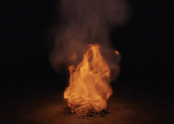
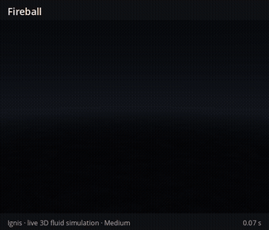
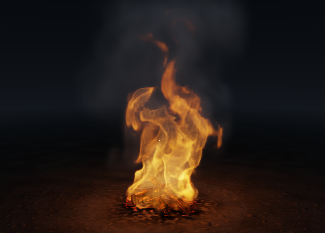
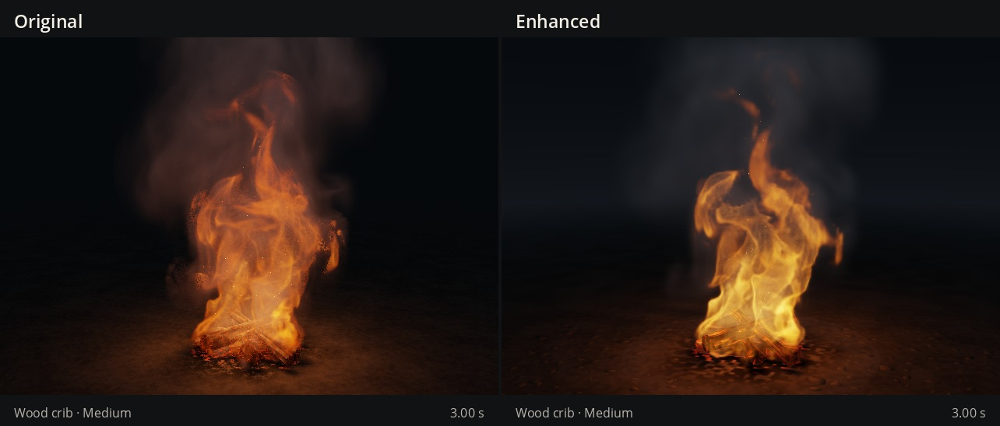

# CYBR FIRE — Ignis Fire Dynamics Lab

A browser-based fire and smoke simulator with an interactive 3D viewport, scenario presets, and alternate combustion models. This branch contains the restored Ignis browser build, including the archived V10 look, reference recordings, and a downloadable archive. It is not the older native CUDA/C++ project.



*Loop made from the shipped WebGL wood-crib recording (48 × 72 × 48 cells as labeled in the app). This is a recording, not a performance benchmark.*

## Run locally

```sh
git clone https://github.com/cybrdelic/cybr-fire-native.git
cd cybr-fire-native
python -m http.server 8000 --directory dist
```

Open [localhost:8000](http://localhost:8000/). No build step is needed for the checked-in browser files. Use HTTP instead of opening the HTML as a local file, so the browser loads its JavaScript modules normally. To host it elsewhere, serve the full `dist/` folder so the media and archive paths keep working.

## What to try

- **Scenarios:** Wood crib, Pool fire, Jet flame, Crosswind, Fireball, Ground burst, Ember bed, and Pulsing vent. Select a burst preset to try its replay control.
- **Interact:** Drag to orbit and scroll or pinch to zoom. Use the viewport brush to ignite locally, and the Wood crib ignition controls to cold-restart or ignite the fuel bed. Pause, single-step, or restart to inspect the result.
- **Compare models:** Switch among Enhanced, Original, and Revised. Enhanced has controls for stable sampling, shared fire lighting, and thermal expansion. The in-app Compare panel includes archived references.
- **Inspect the simulation:** Change fuel feed, wind, turbulence, and oxygen supply. Switch from Composite to gas temperature, smoke, velocity, or wood temperature where available. Change quality and exposure independently.
- **Choose a backend:** Start with **3D · WebGL** on a WebGL2-capable browser. **3D · CPU** and **2D slice** are alternate paths, not equivalent GPU benchmarks. Lower quality if the viewport struggles. Use **Measure 10 s** in the timing panel to profile your own browser, hardware, backend, and quality settings.



*Excerpt from the shipped presets reel. [Full video](dist/media/presets-reel.mp4).*

## Gallery





[Wood crib recording](dist/media/wood-crib.mp4) · [Enhanced comparison recording](dist/media/ignis-enhanced-comparison.mp4) · [Download Ignis archive](dist/downloads/Ignis.zip)

## Repository layout

| Path | Contents |
| --- | --- |
| `dist/index.html`, `dist/main.js` | Interface, controls, and application wiring |
| `dist/fluid.js`, `dist/render.js`, `dist/lighting.js`, `dist/timing.js` | Volumetric solver, display, lighting, and timing |
| `dist/fallback.js`, `dist/enhanced/`, `dist/original/` | Fallback and alternate model implementations |
| `dist/media/`, `dist/downloads/` | Shipped recordings, comparison stills, and downloadable archive |
| `docs/media/` | GIF previews derived from shipped recordings |

## Verification and limits

All shipped JavaScript modules passed a Node syntax check, the bundled ZIP passed `unzip -tq`, and the README GIFs were encoded from the checked-in videos. These checks do not establish graphics-driver compatibility, sustained FPS, physical accuracy, or parity between the three backends. Use the in-app timing measurement for local performance data. The simulator is for visualization, not fire-safety or engineering prediction.
